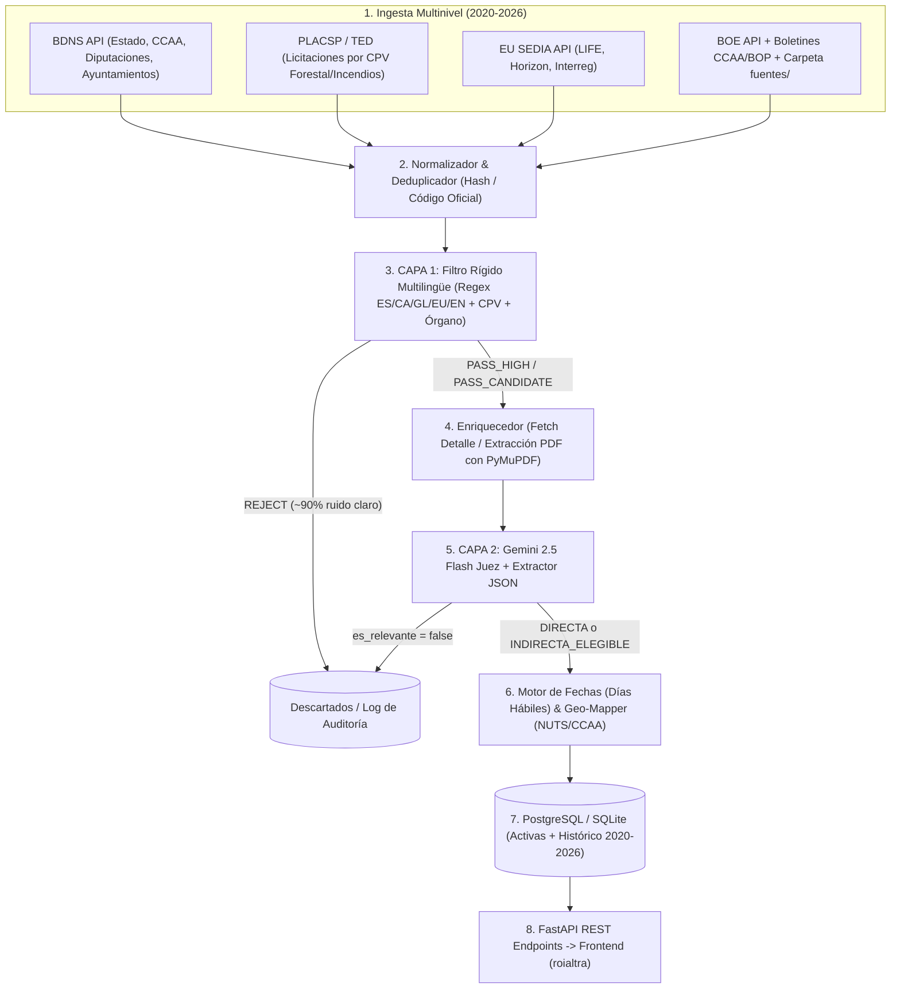

# Plan Maestro de Proyecto — Plataforma de Oportunidades de Reforestación e Incendios (`1hack_reforesta`)

> **Estado:** Diseño Aprobado — Versión 1.1 (Decisiones Técnicas Cerradas)  
> **Fecha de inicio:** Viernes 13/11/2026  
> **Meta de entrega:** Lunes 16/11/2026 (Plataforma funcional y lista para uso real)  
> **División de equipo:**  
> - **Backend & Data/IA (`fedellor`)** — Rama `back`: Ingesta masiva `2020–2026` (UE, Estado, CCAA, Provincias, Municipios), Pipeline de Filtrado Híbrido Multilingüe (Regex + Gemini Juez), Base de Datos (Activas + Histórico Profundo) y API REST en FastAPI.  
> - **Frontend & Visualización (`roialtra`)** — Rama `front`: Mapa interactivo de España por CCAA, buscador/filtros avanzados, vista de oportunidades activas, explorador de histórico (`2020–2026`) y ficha de detalle.

---

## 1. Visión, Metas y Decisiones Técnicas Cerradas

### 1.1. Meta Principal
Construir el **radar definitivo de financiación y contratación pública en España y la UE (aplicable a territorio español)** para proyectos de **reforestación, silvicultura, restauración ecológica y prevención/extinción de incendios forestales**, abarcando desde programas de la Comisión Europea hasta convocatorias de pequeños ayuntamientos, distinguiendo con precisión las **oportunidades activas** (en plazo hoy) de un **archivo histórico profundo (`2020–2026`)**.

### 1.2. Stack y Decisiones de Arquitectura Confirmadas
| Componente | Decisión Cerrada | Justificación Técnica |
| :--- | :--- | :--- |
| **Lenguaje y API Backend** | **Python 3.11+ & FastAPI** | Ecosistema nativo para scraping asíncrono (`httpx`/`asyncio`), extracción de PDFs (`PyMuPDF`/`fitz`), validación (`Pydantic v2`) y OpenAPI automático para el Front. |
| **Base de Datos** | **PostgreSQL Cloud (Supabase / Neon) + Fallback SQLite local** | Mediante `SQLAlchemy 2.0` / `SQLModel`, una simple variable `DATABASE_URL` permite desarrollar en local con SQLite al instante y sincronizar en Postgres en la nube para que el Front consuma datos reales sin bloqueos. |
| **LLM Juez y Extractor (Capa 2)** | **Google Gemini (`gemini-2.5-flash`)** | Ventana de contexto masiva (1M tokens) capaz de leer órdenes autonómicas completas en PDF sin truncar, soporte nativo de *Structured Outputs* (`response_schema` con Pydantic), rapidísimo y de coste mínimo para procesar el histórico `2020–2026`. |
| **Rango del Histórico** | **Histórico Profundo (`2020–2026`)** | 7 años de cobertura (incluyendo todo el ciclo NextGenerationEU / PRTR, PAC 2023-2027 y LIFE 2021-2027) para permitir análisis de tendencias, estacionalidad de convocatorias y comparativas por CCAA. |
| **Tipología de Oportunidades** | **Subvenciones/Ayudas + Licitaciones/Contratos Públicos + Programas UE** | Cubre tanto a quien busca financiación a fondo perdido (ONGs, propietarios, ayuntamientos, investigadores) como a empresas forestales que buscan contratos públicos de repoblación o prevención de incendios. |
| **Clasificación de Relevancia** | **Doble Nivel: `DIRECTA` + `INDIRECTA_ELEGIBLE`** | Permite mostrar por defecto o filtrar las ayudas 100% forestales/incendios (`DIRECTA`) sin perder convocatorias paraguas de biodiversidad/clima/medio ambiente donde cabe perfectamente un proyecto de reforestación (`INDIRECTA_ELEGIBLE`). |
| **Soporte Multilingüe** | **ES + CA + GL + EU + EN (Comisión Europea) → Salida en Español** | La Capa 1 detecta términos en castellano, catalán, gallego, euskera e inglés, y Gemini traduce/normaliza siempre el título limpio, el resumen y la justificación al español. |

### 1.3. Golden Benchmark (Criterio de Éxito de Detección)
> **Prueba de fuego del sistema:** La plataforma, al ejecutar sus conectores de ingesta y su pipeline híbrido sobre las fuentes oficiales (BDNS, BOE, BOCM, etc.), **debe descubrir, capturar y clasificar automáticamente —entre miles de convocatorias— las 2 oportunidades de referencia de la carpeta `fuentes/`**:
> 1. **MITECO — Código BDNS `923290`** ([miteco-convocatoria-923290.pdf](file:///C:/Users/dsuarezc.INDRA/Downloads/reforesta/fuentes/miteco-convocatoria-923290.pdf)): *Ayudas concurrencia competitiva Línea A desarrollo actividades interés general consideradas interés social, en el ámbito de la investigación científica y técnica y protección medio ambiente en materias de competencia estatal (`17.389.322,52 €`)*.
> 2. **Comunidad de Madrid — Orden `1689/2026`** ([comunidad-madrid-orden-1689-2026.pdf](file:///C:/Users/dsuarezc.INDRA/Downloads/reforesta/fuentes/comunidad-madrid-orden-1689-2026.pdf)): *Convocatoria de ayudas para la concesión de subvenciones públicas a entidades sin ánimo de lucro, destinadas a financiar la realización de actividades y proyectos ambientales en la Comunidad de Madrid (`500.000 €`, máx. `60.000 €`/entidad y `30.000 €`/proyecto)*.
>
> Incluiremos un **test automatizado de validación (`test_golden_benchmark.py`)** que verificará que ambas son capturadas por la ingesta, superan tanto la Capa 1 como la Capa 2, y tienen todos sus importes, plazos y metadatos correctamente estructurados.

---

## 2. Hallazgos Clave del Análisis de `fuentes/` (Impacto en el Diseño del Back)

Al inspeccionar los dos documentos iniciales descargados en `fuentes/` ([miteco-convocatoria-923290.pdf](file:///C:/Users/dsuarezc.INDRA/Downloads/reforesta/fuentes/miteco-convocatoria-923290.pdf) y [comunidad-madrid-orden-1689-2026.pdf](file:///C:/Users/dsuarezc.INDRA/Downloads/reforesta/fuentes/comunidad-madrid-orden-1689-2026.pdf)), detectamos **3 problemas reales de los datos públicos** que nuestro Backend resuelve por diseño:

1. **Metadatos oficiales mal etiquetados en origen**:
   - En `miteco-convocatoria-923290.pdf` (17,38 M€ del MITECO para protección del medio ambiente), el campo oficial *Sector económico del beneficiario* en BDNS dice literalmente **`ACTIVIDADES INMOBILIARIAS`** y *Finalidad* dice **`Investigación, desarrollo e innovación`**.
   - **Regla de diseño**: El filtro **jamás** descartará una convocatoria por el sector CNAE/actividad de la ficha BDNS; evaluará siempre título, órgano convocante, extracto y bases reguladoras.
2. **Títulos administrativos genéricos**:
   - En `comunidad-madrid-orden-1689-2026.pdf` (500.000 €), el título solo menciona *"actividades y proyectos ambientales"*, sin usar la palabra *"reforestación"*. Solo al analizar los Artículos 1 y 12 aparecen *Red Natura 2000, conservación de hábitats, flora silvestre, árboles singulares y adaptación al cambio climático*.
   - **Regla de diseño**: Estas convocatorias entran por el bloque ambiental de Capa 1 + órgano convocante (*Consejería de Medio Ambiente*), y el LLM Juez las etiqueta como `INDIRECTA_ELEGIBLE` explicando qué líneas financian.
3. **Plazos relativos al boletín oficial**:
   - MITECO indica: *"15 días hábiles tras publicación extracto BOE"*. Madrid indica: *"10 días hábiles a contar desde el día siguiente al de la publicación del extracto en el BOCM"*.
   - **Regla de diseño**: Nuestro **Motor de Resolución de Fechas** toma primero las fechas ISO (`fechaInicioSolicitud`, `fechaFinSolicitud`) calculadas en la API de la BDNS/PLACSP/UE; cuando solo existe texto en PDF, calcula la fecha sumando los días hábiles (descontando fines de semana y festivos) a la fecha de publicación del extracto.

---

## 3. Estrategia de Fuentes de Datos ("Encontrar TODO": 2020–2026)

Para cubrir los **8.131 ayuntamientos, 50 provincias, 17 CCAA, el Estado y la Unión Europea** desde 2020 hasta 2026 de forma sólida y automatizada:

### Nivel 1: Agregadores Oficiales de España (Estado + 17 CCAA + 50 Diputaciones + 8.131 Ayuntamientos)
1. **BDNS / SNPSAP (`pap.hacienda.gob.es/bdnstrans`) — El Conector Maestro de Subvenciones**:
   - **Por qué es clave**: Por mandato de la Ley 38/2003 General de Subvenciones (Art. 18 y 20), **cualquier subvención de un ayuntamiento, diputación, cabildo, CCAA o ministerio español tiene que registrarse obligatoriamente en la BDNS** para ser válida en su boletín oficial.
   - **Cobertura**: Subvenciones y ayudas públicas `2020–2026` de todos los niveles territoriales de España.
   - **Estrategia de extracción**: Consultas paginadas a la API REST del portal SNPSAP filtrando por rangos de fechas (`2020–2026`) y baterías de términos clave + descarga del JSON de detalle de cada convocatoria (`codigo_bdns`, órgano, región NUTS/CCAA, fechas exactas de inicio/fin de solicitud, presupuesto, enlaces a bases y sede electrónica).
2. **PLACSP — Plataforma de Contratación del Sector Público (`contrataciondelestado.es`)**:
   - **Por qué es clave**: Los contratos de obras y servicios forestales (repoblación, silvicultura, desbroces preventivos, cortafuegos, extinción, restauración post-incendio) son **licitaciones públicas**, no subvenciones.
   - **Cobertura**: Licitaciones del Estado, CCAA, Diputaciones y Ayuntamientos (`2020–2026`).
   - **Estrategia de extracción**: Ingesta de paquetes de Datos Abiertos / Sindicación Atom-CODICE filtrando por códigos **CPV** (`77200000` Servicios forestales, `77231600` Repoblación forestal, `75251120` Prevención de incendios forestales, `90710000` Gestión medioambiental, `90721800` Protección contra riesgos naturales).
3. **BOE Datos Abiertos (`boe.es/datosabiertos/api`)**:
   - **Cobertura**: Sumarios diarios XML/JSON para capturar convenios forestales, reales decretos de ayudas directas por grandes incendios forestales, declaraciones de zonas gravemente afectadas por emergencias de protección civil (incendios) y convocatorias estatales.

### Nivel 2: Programas Europeos (Comisión Europea → Aplicables en España)
4. **EU Funding & Tenders Portal (SEDIA Search API) + TED (Tenders Electronic Daily)**:
   - **Cobertura (`2020–2026`)**:
     - **Programa LIFE**: Subprogramas *Nature and Biodiversity* (`LIFE-NAT`) y *Climate Change Mitigation and Adaptation* (`LIFE-CCA`).
     - **Horizon Europe (y H2020 en 2020)**: Clúster 6 (*Food, Bioeconomy, Natural Resources, Agriculture and Environment*), *EU Mission: Adaptation to Climate Change* y *EU Mission: A Soil Deal for Europe* (restauración de suelos forestales y prevención de desertificación/incendios).
     - **Interreg (Cooperación Territorial Europea)**: Programas **POCTEP** (España-Portugal, muy enfocado en incendios ibéricos), **SUDOE** (Sudoeste Europeo), **POCTEFA** (Pirineos) y **Euro-MED**.
     - **TED (Suplemento del Diario Oficial de la UE)**: Licitaciones públicas europeas de alto importe ejecutadas en España con CPVs forestales/incendios.

### Nivel 3: Boletines Autonómicos (17 CCAA), Provinciales (BOPs) y Enriquecimiento PDF
5. **Enriquecedor Documental de Boletines (BOCM, BOJA, DOGC, DOGV, DOGA, BOCYL, BOA, DOE, BOPA, etc.)**:
   - Cuando una convocatoria de BDNS o BOE referencia un PDF de bases reguladoras o extracto en un diario autonómico/provincial (o se ingesta directamente de la carpeta `fuentes/`), el **Extractor PDF (`PyMuPDF`)** descarga el documento, extrae las secciones clave (*Objeto, Beneficiarios, Cuantía individual, Gastos subvencionables, Criterios de valoración*) y alimenta a Gemini.

---

## 4. Arquitectura del Pipeline de Filtrado Híbrido Multilingüe

### 4.1. Capa 1: Filtro Rígido Multilingüe (Coste 0 tokens, < 5 ms/documento)

#### A. Matriz de Expresiones Regulares por Idioma (ES / CA / GL / EU / EN)
- **Bloque 1: Reforestación, Silvicultura y Montes (`PESO ALTO = +50 pts`)**
  - **ES**: `\b(reforest\w*|repoblaci[oó]n\s+forestal|forestaci[oó]n|silvicult\w*|selvicult\w*|masa[s]?\s+forestal\w*|monte[s]?\s+(p[uú]blico|vecinal|comunal)\w*|plantaci[oó]n\s+de\s+[aá]rbol\w*|vivero[s]?\s+forestal\w*|restauraci[oó]n\s+(ecol[oó]gica|ambiental|forestal|hidrol[oó]gico-forestal)|sumidero[s]?\s+de\s+carbono|absorci[oó]n\s+de\s+co2|renaturalizaci[oó]n|infraestructura\s+verde|dehesa\w*|agroforest\w*)\b`
  - **CA (Catalán/Valenciano)**: `\b(reforest\w*|repoblaci[oó]\s+forestal|silvicult\w*|gesti[oó]\s+forestal|bosc(os)?\b|massa\s+forestal|restauraci[oó]\s+(ecol[oò]gica|ambiental)|infraestructura\s+verda|renaturalitzaci[oó])\b`
  - **GL (Gallego)**: `\b(reforest\w*|repoboaci[oó]n\s+forestal|silvicult\w*|monte[s]?\s+veciñal\w*|comunidade[s]?\s+de\s+montes|masa[s]?\s+forestal\w*|frondosas\s+aut[oó]ctonas|restauraci[oó]n\s+ecol[oó]xica)\b`
  - **EU (Euskera)**: `\b(baso[-\s]?berritze\w*|basogintza\w*|baso[-\s]?kudeaketa\w*|mendi\s+publiko\w*)\b`
  - **EN (Comisión Europea)**: `\b(reforest\w*|afforest\w*|silvicult\w*|forest\s+(management|restoration|conservation|ecosystem\w*|resilience)|tree\s+planting|agroforestry|ecological\s+restoration|nature\s+restoration|carbon\s+(sink\w*|farming|sequestration)|urban\s+greening|rewilding)\b`

- **Bloque 2: Incendios Forestales (`PESO ALTO = +50 pts`)**
  - **ES**: `\b(incendio[s]?\s+forestal\w*|prevenci[oó]n\s+de\s+incendios|extinci[oó]n\s+de\s+incendios|cortafuego[s]?|faja[s]?\s+(auxiliar|pir[oó]fuga)\w*|desbroce\w*|biomasa\s+forestal|limpieza\s+de\s+montes|zonas\s+(incendiadas|quemadas)|piroecolog\w*|vigilancia\s+forestal|brigada[s]?\s+forestal\w*)\b`
  - **CA**: `\b(incendi[s]?\s+forestal\w*|prevenci[oó]\s+d'incendis|tallafoc[s]?|franges\s+de\s+protecci[oó]|biomassa\s+forestal|estassada)\b`
  - **GL**: `\b(incendio[s]?\s+forestal\w*|lume[s]?\s+forestal\w*|prevenci[oó]n\s+de\s+incendios|devasa[s]?|faixa[s]?\s+secundaria\w*|roza[s]?\s+forestal\w*|biomasa\s+forestal)\b`
  - **EU**: `\b(baso[-\s]?sute\w*|suteen\s+prebentzio\w*|su[-\s]?eten\w*)\b`
  - **EN**: `\b(wildfire[s]?|forest\s+fire[s]?|fire\s+(prevention|management|resilience|suppression)|fuel\s+management|post[-\s]?fire\s+restoration|prescribed\s+burning)\b`

- **Bloque 3: Biodiversidad, Clima y Proyectos Ambientales (`PESO MEDIO = +25 pts`)**
  - `\b(biodiversidad\w*|biodiversity|patrimonio\s+natural|red\s+natura\s+2000|natura\s+2000|espacios\s+naturales\s+protegidos|h[aá]bitats\s+de\s+inter[eé]s\s+comunitario|[aá]rboles\s+singulares|flora\s+silvestre|adaptaci[oó]n\s+al\s+cambio\s+clim[aá]tico|climate\s+adaptation|proyectos\s+ambientales|custodia\s+del\s+territorio|erosi[oó]n\s+de\s+suelos|desertificaci[oó]n)\b`

#### B. Reglas de Boost y Exclusión en Capa 1
- **Boost por Órgano (`+20 pts`)**: Si el órgano convocante contiene `MITECO`, `Transición Ecológica`, `Medio Ambiente`, `Medi Ambient`, `Medio Rural`, `Montes`, `Biodiversidad`, `Parques Nacionales`, `Confederación Hidrográfica`, `CINEA` (agencia ejecutiva europea de LIFE/Clima).
- **Boost por Código CPV (`+60 pts`)**: Cualquier licitación con CPV `772*`, `75251120`, `9071*`, `90721800`.
- **Exclusión Rápida (`-100 pts` si no tiene match explícito de Bloque 1/2)**:
  - Falsos positivos típicos: `"extinción de condominio"`, `"extinción de contrato"`, `"monte de piedad"`, `"extintores"`, `"alarma contra incendios en edificio/colegio/hospital"`, `"protección pasiva contra incendios en nave"`, `"césped artificial"`.
- **Umbral de Paso a Capa 2**: Pasa cualquier documento con **`score_capa1 >= 25`**.

---

### 4.2. Capa 2: LLM Juez (`gemini-2.5-flash`) + Estrategia para Histórico `2020–2026`

Para procesar tanto las convocatorias activas de 2026 como el histórico `2020–2025` de forma rápida y económica:
1. **Modo Batch / Concurrencia Asíncrona**:
   - Llamadas concurrentes controladas (`asyncio.Semaphore(15)`) a `gemini-2.5-flash` usando `response_schema` (Pydantic).
2. **Enriquecimiento Selectivo de PDFs**:
   - Para convocatorias **ACTIVAS (o 2026)**: descargamos y leemos el PDF completo de la orden/bases (si está disponible) para extraer hasta el último detalle (importes máximos individuales, criterios de puntuación, documentación).
   - Para convocatorias **CERRADAS del Histórico (`2020–2025`)**: evaluamos y extraemos directamente sobre la ficha BDNS/extracto (sin descargar miles de PDFs antiguos de 30 páginas salvo que falten datos críticos), multiplicando por 10x la velocidad de carga del histórico.
3. **Traducción y Normalización Automática**:
   - Si el documento original está en **inglés (UE)**, **catalán**, **gallego** o **euskera**, Gemini conserva el `titulo_original` e `idioma_original`, pero genera `titulo_limpio`, `resumen`, `justificacion` y `requisitos` **en español neutro**.

---

## 5. Modelo de Base de Datos y Contrato de API (`back` ↔ `front`)

### 5.1. Tabla Principal `opportunities` (SQLModel / PostgreSQL & SQLite)
- `id` (`PK`, string, ej. `bdns-923290`, `placsp-2026-0012`, `eu-life-2026-nat-01`, `doc-madrid-1689-2026`)
- `codigo_oficial` (string, indexado)
- `fuente` (`BDNS` | `PLACSP` | `BOE` | `EU_SEDIA` | `BOLETIN_CCAA` | `MANUAL_PDF`)
- `tipo_oportunidad` (`SUBVENCION` | `LICITACION` | `PROGRAMA_UE` | `CONVENIO`)
- `estado` (`ACTIVA` | `PROXIMA` | `CERRADA`, indexado)
- `relevancia_tipo` (`DIRECTA` | `INDIRECTA_ELEGIBLE`, indexado)
- `relevancia_score` (int `0-100`, indexado)
- `categorias` (JSON array: `["reforestacion", "prevencion_incendios", "restauracion_post_incendio", "silvicultura", "biodiversidad", "absorcion_carbono", "investigacion_forestal"]`)
- `idioma_original` (`es` | `ca` | `gl` | `eu` | `en`)
- `titulo_limpio` (string, siempre en español)
- `titulo_original` (text)
- `resumen` (text, en español)
- `justificacion_juez` (text, por qué aplica y qué proyectos encajan)
- `nivel_territorial` (`UE` | `ESTADO` | `CCAA` | `PROVINCIA` | `MUNICIPIO`, indexado)
- `ccaa_codigo` (string ISO/INE: `ES-AN`, `ES-AR`, `ES-AS`, `ES-CB`, `ES-CE`, `ES-CL`, `ES-CM`, `ES-CN`, `ES-CT`, `ES-EX`, `ES-GA`, `ES-IB`, `ES-MC`, `ES-MD`, `ES-ML`, `ES-NC`, `ES-PV`, `ES-RI`, `ES-VC`, o globales `ES` / `EU`, indexado)
- `ccaa_nombre` (string)
- `provincia_codigo` / `provincia_nombre` (nullable string, indexado)
- `municipio_nombre` (nullable string)
- `organo_convocante` (string)
- `presupuesto_total` (numeric, nullable, indexado)
- `importe_max_proyecto` (numeric, nullable)
- `importe_max_beneficiario` (numeric, nullable)
- `porcentaje_financiacion` (float, nullable)
- `cofinanciado_ue` (boolean)
- `fondo_ue` (nullable string: `LIFE`, `FEADER`, `FEDER`, `NextGenerationEU`, `Horizon Europe`, `Interreg`)
- `beneficiarios_tipos` (JSON array: `["AYUNTAMIENTO", "ONG_FUNDACIONES", "EMPRESA_PYME", "PARTICULAR_PROPIETARIO", "COMUNIDAD_MONTES", "UNIVERSIDAD_INVESTIGACION"]`)
- `requisitos_resumen` (text)
- `criterios_valoracion` (JSON array opcional, extraído de PDFs)
- `fecha_publicacion` (date, indexado)
- `anio_convocatoria` (int `2020..2026`, indexado para consultas rápidas de histórico)
- `fecha_inicio_solicitud` (date, nullable)
- `fecha_fin_solicitud` (date, nullable, indexado)
- `plazo_texto_original` (string, nullable)
- `es_plazo_calculado` (boolean)
- `url_ficha_oficial` (string)
- `url_tramitacion` (string, nullable)
- `url_bases_pdf` (string, nullable)

### 5.2. Códigos de CCAA Estándar para el Mapa de `roialtra`
Para evitar cualquier descuadre entre el GeoJSON/SVG del Front y la API del Back, usaremos los **19 códigos ISO 3166-2:ES** más `ES` (Nacional) y `EU` (Europeo):
`ES-AN` (Andalucía), `ES-AR` (Aragón), `ES-AS` (Asturias), `ES-CB` (Cantabria), `ES-CE` (Ceuta), `ES-CL` (Castilla y León), `ES-CM` (Castilla-La Mancha), `ES-CN` (Canarias), `ES-CT` (Cataluña), `ES-EX` (Extremadura), `ES-GA` (Galicia), `ES-IB` (Illes Balears), `ES-MC` (Región de Murcia), `ES-MD` (Comunidad de Madrid), `ES-ML` (Melilla), `ES-NC` (Navarra), `ES-PV` (País Vasco), `ES-RI` (La Rioja), `ES-VC` (Comunitat Valenciana) + `ES` (Estatal) + `EU` (Unión Europea).

---

## 6. Hoja de Ruta de Ejecución en Rama `back`

### Etapa 1 — Cimientos, Base de Datos y Contrato API (Inmediato)
1. Crear rama `back` y estructura de carpetas limpia (`app/main.py`, `app/models.py`, `app/schemas.py`, `app/database.py`, `app/pipeline/`, `app/ingestors/`, `app/routers/`).
2. Configurar conexión dual SQLite/PostgreSQL y levantar los endpoints REST con datos reales extraídos de los 2 PDFs de `fuentes/` para que `roialtra` tenga la API lista desde ya.

### Etapa 2 — Motor de Filtrado Híbrido (Capa 1 + Capa 2 Gemini + Fechas)
1. Implementar `Layer1Filter` con la matriz multilingüe (`ES`, `CA`, `GL`, `EU`, `EN`), códigos CPV, boost de órganos y reglas anti-ruido.
2. Implementar `Layer2GeminiJudge` con `google-genai` y esquema Pydantic estricto + traductor/normalizador al español.
3. Implementar `DateResolver` para convertir plazos relativos (*"10 días hábiles desde el día siguiente..."*) en fechas calendario reales y calcular `estado` (`ACTIVA` / `CERRADA`) y `dias_restantes`.

### Etapa 3 — Conectores de Ingesta Masiva (`2020–2026`)
1. **Conector BDNS (`bdns_ingestor.py`)**: Búsqueda y descarga asíncrona de subvenciones `2020–2026` (Estado + CCAA + Diputaciones + Ayuntamientos) + mapeo geográfico automático a `ccaa_codigo` y provincia.
2. **Conector Europeo (`eu_sedia_ingestor.py`)**: Extracción de convocatorias `2020–2026` de **LIFE**, **Horizon Europe** e **Interreg** desde la API oficial de la Comisión Europea.
3. **Conector Licitaciones (`placsp_ingestor.py`)**: Captura de licitaciones públicas de servicios forestales y prevención/extinción de incendios en España.
4. **Conector BOE y Boletines Autonómicos (`boe_ccaa_ingestor.py`)**: Captura del sumario BOE y enriquecimiento de PDFs de órdenes autonómicas.

### Etapa 4 — Verificación, Histórico y Endpoint de Demo en Vivo
1. Poblar la base de datos con el lote completo `2020–2026` validado por el Juez.
2. Verificar conteos por CCAA en `/api/v1/map/summary` y estadísticas históricas en `/api/v1/stats/historical`.
3. Añadir endpoint `POST /api/v1/analyze-document` para subir un PDF o URL en directo durante la presentación del lunes.
