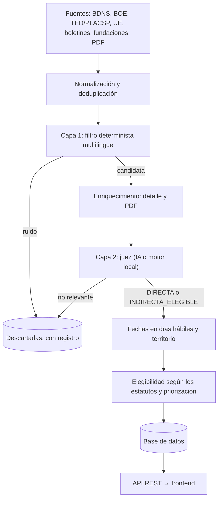

# Diseño técnico del backend

Cómo está construido el backend del Radar Reforesta y por qué. El qué y el para qué están en [REQUERIMIENTOS.md](REQUERIMIENTOS.md); cómo se arranca, en el [README](README.md).

---

## 1. Decisiones de arquitectura

| Componente | Decisión | Motivo |
| :--- | :--- | :--- |
| API | Python 3.11+ y FastAPI | Scraping asíncrono (`httpx`), PDF con PyMuPDF, validación con Pydantic v2 y OpenAPI automático |
| Base de datos | SQLite por defecto; PostgreSQL con `DATABASE_URL` | SQLModel/SQLAlchemy: se desarrolla en local al instante y se puede pasar a Postgres sin tocar código |
| Clasificación de capa 2 | Gemini, Groq u OpenRouter si hay clave; motor determinista local si no | Sin dependencia obligatoria de una API externa. Las respuestas del juez se guardan en caché |
| Histórico | Desde 2016 (`INGEST_START_YEAR`) | Cubre ciclos completos (NextGenerationEU, PAC 2023–27, LIFE 2021–27) y permite medir la recurrencia |
| Tipos de oportunidad | Subvenciones, licitaciones, programas UE y mecenazgo | Reforesta busca ayudas y también contratos que podría ejecutar |
| Relevancia | `DIRECTA` e `INDIRECTA_ELEGIBLE` | Mantiene las ayudas paraguas de medio ambiente y clima donde cabe un proyecto de reforestación |
| Idiomas | ES, CA, GL, EU y EN → salida en español | La capa 1 detecta términos en los cinco idiomas y se normalizan título y resumen |
| Plazos | Días hábiles según el art. 30 de la Ley 39/2015, con los calendarios nacional y autonómicos | Un plazo mal contado invalida una solicitud |

## 2. Caso de prueba de referencia

Los dos documentos de `fuentes/` deben ser capturados y clasificados por el pipeline entre miles de convocatorias. Lo verifica `tests/test_golden_benchmark.py`.

1. **MITECO, BDNS `923290`** ([PDF](fuentes/miteco-convocatoria-923290.pdf)): ayudas de interés general en protección del medio ambiente, 17.389.322,52 €.
2. **Comunidad de Madrid, Orden `1689/2026`** ([PDF](fuentes/comunidad-madrid-orden-1689-2026.pdf)): subvenciones a entidades sin ánimo de lucro para proyectos ambientales, 500.000 € (máximo 60.000 € por entidad y 30.000 € por proyecto).

## 3. Lo que enseñaron esos documentos

1. **Metadatos mal etiquetados en origen.** La ficha de BDNS del MITECO dice «Actividades inmobiliarias» como sector. *Regla:* nunca se descarta una convocatoria por el sector de la ficha; se evalúan título, órgano, extracto y bases.
2. **Títulos genéricos.** La orden de Madrid habla de «proyectos ambientales», sin la palabra «reforestación». *Regla:* entran por el bloque ambiental de la capa 1 y el órgano convocante, y el juez las marca `INDIRECTA_ELEGIBLE` explicando qué líneas financian.
3. **Plazos relativos al boletín.** «15 días hábiles tras el extracto en el BOE». *Regla:* el resolutor de fechas usa primero las fechas ISO de las APIs. Si solo hay texto, suma días hábiles a la publicación del extracto.

## 4. Fuentes

| Fuente | Qué aporta | Conector |
| :--- | :--- | :--- |
| BDNS (SNPSAP) | Toda subvención de cualquier administración española, obligatoria por la Ley 38/2003 | `app/ingestors/live_connectors.py` |
| PLACSP y TED | Licitaciones forestales, filtradas por códigos CPV (`77200000`, `77231600`, `75251120`, `90710000`, `90721800`) | ídem |
| BOE (datos abiertos) | Sumarios diarios, convenios y ayudas directas | ídem |
| Boletines de las 19 comunidades | Convocatorias y bases autonómicas (RSS) | ídem |
| UE (SEDIA) | LIFE, Horizon Europe, Interreg | ídem |
| Fundaciones y empresas | Mecenazgo y RSC, por seguimiento de sus webs | `app/ingestors/web_monitors.py` |
| PDF locales | Documentos en `fuentes/` | `app/ingestors/fuentes_local.py` |

Cuando una convocatoria referencia unas bases en PDF, el extractor (`app/pipeline/pdf_extractor.py`) lee las secciones clave (objeto, beneficiarios, cuantía, gastos, criterios).

## 5. Pipeline

- **Capa 1** (`app/pipeline/layer1_regex.py`): sin coste, muy rápida. Puntúa por bloques temáticos (reforestación y silvicultura, incendios forestales, biodiversidad y clima), suma si el órgano o el código CPV son del sector, y resta si el texto encaja con falsos positivos conocidos («extinción de condominio», «monte de piedad»…). Pasa a la capa 2 lo que llega al umbral `LAYER1_THRESHOLD`. Las expresiones regulares están en el propio archivo.
- **Capa 2** (`app/pipeline/layer2_judge.py`): decide si es relevante, la clasifica, traduce y normaliza al español y extrae un JSON con importes, beneficiarios y citas. Con llamadas concurrentes y caché. En el histórico cerrado evalúa sobre la ficha sin descargar miles de PDF antiguos.
- **Elegibilidad** (`app/domain/reforesta_profile.py`): aplica los estatutos de Reforesta y devuelve los requisitos excluyentes.
- **Priorización** (`app/pipeline/prioritizer.py`): puntúa por encaje temático, elegibilidad, atractivo financiero y urgencia del plazo.
- **Fechas** (`app/pipeline/date_resolver.py`): calcula `estado` (`ACTIVA`, `PROXIMA`, `CERRADA`) y días restantes.

## 6. Modelo de datos

Tabla `opportunities` (`app/models.py`), con los campos principales:

| Grupo | Campos |
| :--- | :--- |
| Identificación | `id`, `codigo_oficial`, `fuente` (`BDNS`, `PLACSP`, `BOE`, `EU_SEDIA`, `BOLETIN_CCAA`, `MANUAL_PDF`), `tipo_oportunidad` (`SUBVENCION`, `LICITACION`, `PROGRAMA_UE`, `CONVENIO`), `estado` |
| Relevancia | `relevancia_tipo`, `relevancia_score`, `categorias`, `justificacion_juez`, `idioma_original` |
| Texto | `titulo_limpio`, `titulo_original`, `resumen`, `requisitos_resumen`, `criterios_valoracion` |
| Territorio | `nivel_territorial`, `ccaa_codigo`, `ccaa_nombre`, `provincia_*`, `municipio_nombre`, `organo_convocante` |
| Dinero | `presupuesto_total`, `importe_max_proyecto`, `importe_max_beneficiario`, `porcentaje_financiacion`, `cofinanciado_ue`, `fondo_ue` |
| Beneficiarios | `beneficiarios_tipos` (`AYUNTAMIENTO`, `ONG_FUNDACIONES`, `EMPRESA_PYME`, `PARTICULAR_PROPIETARIO`, `COMUNIDAD_MONTES`, `UNIVERSIDAD_INVESTIGACION`) |
| Fechas | `fecha_publicacion`, `anio_convocatoria`, `fecha_inicio_solicitud`, `fecha_fin_solicitud`, `plazo_texto_original`, `es_plazo_calculado` |
| Enlaces | `url_ficha_oficial`, `url_tramitacion`, `url_bases_reguladoras` |

La tabla `ingestion_runs` guarda cada sincronización, y `llm_verdict_cache` las respuestas del juez.

**Códigos de comunidad** (ISO 3166-2:ES, los mismos que usa el mapa): `ES-AN`, `ES-AR`, `ES-AS`, `ES-CB`, `ES-CE`, `ES-CL`, `ES-CM`, `ES-CN`, `ES-CT`, `ES-EX`, `ES-GA`, `ES-IB`, `ES-MC`, `ES-MD`, `ES-ML`, `ES-NC`, `ES-PV`, `ES-RI`, `ES-VC`; además `ES` (estatal) y `EU` (europeo).

## 7. Cosas que el backend debería mejorar

Los datos que el backend no encuentra se rellenan hoy con valores por defecto, y el frontend los oculta. Lo ideal, en este orden:

1. **Devolver «sin dato»** en lugar de valores por defecto en cofinanciación (20 %), modalidad de pago y orografía.
2. **Fechas ficticias:** cuando no hay plazo, no inventar `{año}-12-31` ni `{año}-01-15`.
3. **Regla de elegibilidad más estricta**, que hoy deja pasar convocatorias que no encajan (por ejemplo, una cátedra de cultura científica).
4. **Importes de licitaciones:** extraer el valor estimado del contrato de TED; hoy falta en la mayoría.
5. **Exponer el tipo de oportunidad y las categorías** en `/api/convocatorias`, para que la web no tenga que deducirlos.
6. **Propagar los errores de las fuentes:** una sincronización se da por completada aunque una fuente no haya respondido.
7. **Mecenazgo:** apuntar los conectores de fundaciones a las páginas de programas concretos, no a las portadas.
